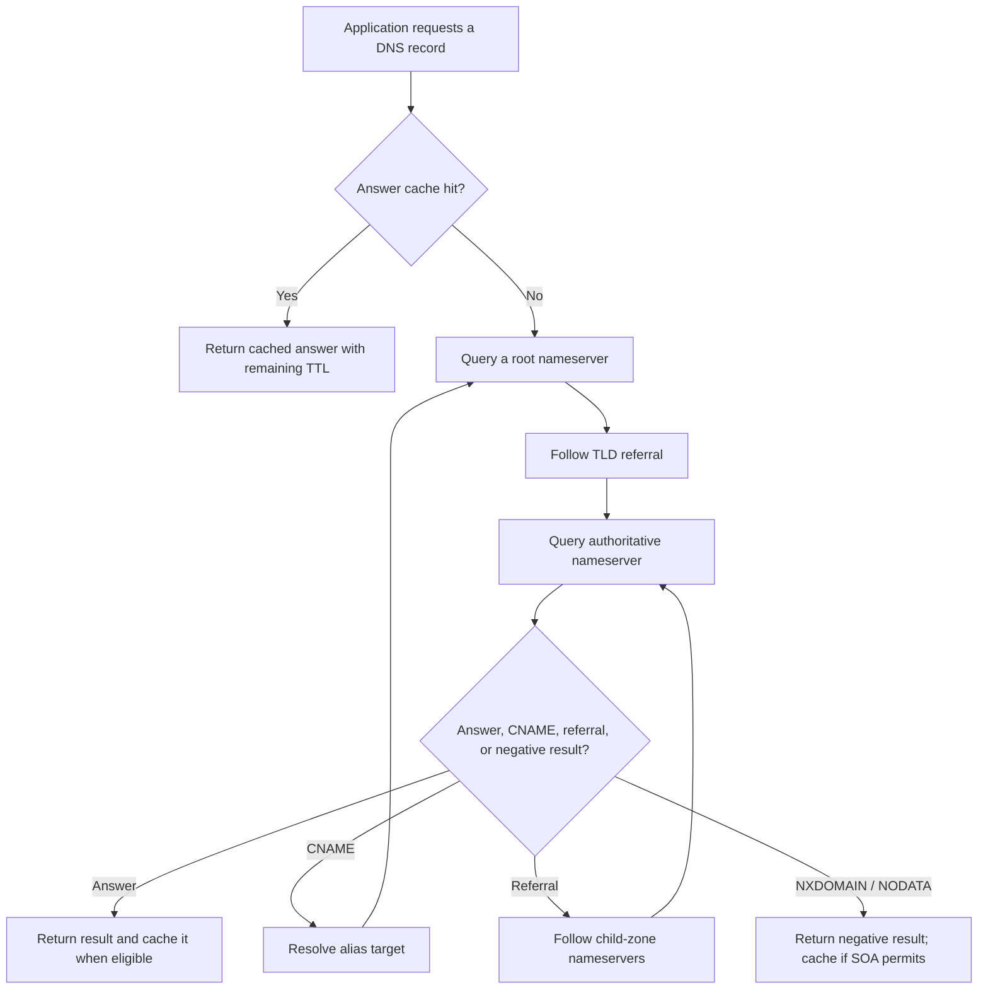
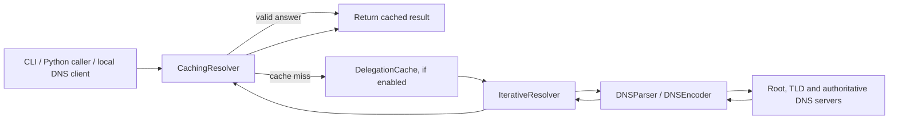

# RootRunner

**A from-scratch iterative DNS resolver for Python, with TTL-aware caching, delegation reuse, server selection, and an optional local DNS server.**

RootRunner explores how DNS resolution works below the usual high-level lookup APIs. Instead of forwarding every cache miss to a public recursive resolver, it walks the DNS hierarchy itself: from root nameservers, through top-level-domain (TLD) referrals, to authoritative nameservers.

The project also includes a DNS wire-format parser/encoder, a bounded answer cache, an optional delegation cache, lookup tracing, a local UDP DNS server, automated tests, and reproducible experiments.

> **Project status:** Academic / experimental project. The resolver has been tested against live DNS infrastructure and through a local Windows DNS configuration, but it is not intended to replace a production recursive resolver.

## Contents

- [Highlights](#highlights)
- [How DNS resolution works](#how-dns-resolution-works)
- [Architecture](#architecture)
- [Supported DNS records](#supported-dns-records)
- [Requirements](#requirements)
- [Installation](#installation)
- [Usage](#usage)
  - [Resolve a name from the command line](#resolve-a-name-from-the-command-line)
  - [Show the resolution trace](#show-the-resolution-trace)
  - [Use the resolver from Python](#use-the-resolver-from-python)
  - [Use the cache](#use-the-cache)
  - [Run the local DNS server](#run-the-local-dns-server)
- [Caching behaviour](#caching-behaviour)
- [Experiments and results](#experiments-and-results)
- [Run the tests](#run-the-tests)
- [Project structure](#project-structure)
- [Current limitations](#current-limitations)
- [Troubleshooting](#troubleshooting)
- [Contributing](#contributing)

## Highlights

- **Iterative DNS resolution:** follows referrals from root servers to TLD and authoritative nameservers rather than relying on a public recursive resolver for each lookup.
- **DNS packet parsing and encoding:** implements DNS headers, questions, resource records, and compressed domain names.
- **IPv4 and IPv6 address lookups:** supports A and AAAA records.
- **CNAME chain following:** follows aliases within a response and restarts resolution when a CNAME points into another zone.
- **Referral and glue processing:** learns child-zone nameservers and uses in-bailiwick glue addresses when available.
- **Glueless delegation handling:** resolves a nameserver's address with a nested lookup when a referral does not include usable glue.
- **UDP with TCP fallback:** retries over TCP when an upstream UDP response has the DNS truncation bit set.
- **Response checks:** validates the transaction ID, response bit, echoed question, and delegation/glue boundaries.
- **RTT-aware nameserver selection:** tracks smoothed round-trip times and penalizes failed servers so slower or unreachable servers are deprioritized.
- **Bounded resolution work:** a shared hop limit prevents endless referral, CNAME, or nested nameserver-resolution loops.
- **TTL-aware answer cache:** supports positive and negative caching, remaining-TTL reporting, LRU eviction, statistics, and CSV lookup logs.
- **Delegation cache:** remembers nameservers for zones so a later lookup for a different name can start closer to the authoritative zone.
- **Local DNS server mode:** exposes the resolver to local clients over UDP on loopback addresses.
- **Experiments and plots:** scripts measure cold/warm latency, delegation reuse, cache hit ratios, failure handling, and query counts compared with `dig +trace`.

## How DNS resolution works

A typical cold lookup proceeds through the DNS hierarchy:



The exact number of network queries depends on the name and the response path. A referral may include glue records, or it may require an additional lookup to find a nameserver's IP address. CNAMEs can also introduce additional zones and queries.

RootRunner uses a built-in list of IPv4 root-server addresses as its starting hints. It sends iterative queries (RD=0) and follows referrals itself.

## Architecture

The implementation is organized around four core modules:

| Module | Responsibility |
| --- | --- |
| `parser.py` | DNS data structures, wire-format parsing and encoding, record decoding, and name compression handling. |
| `resolver.py` | Upstream UDP/TCP transport, iterative resolution, referral traversal, CNAME following, response validation, tracing, and RTT-based server selection. |
| `cache.py` | TTL-aware answer cache, negative caching, LRU eviction, lookup metrics and CSV logging, plus optional delegation caching. |
| `server.py` | Local UDP DNS server that parses client questions, calls the cached resolver, encodes replies, and writes a lookup log on shutdown. |

### Resolution and caching flow



By default, `CachingResolver()` uses a `DelegatingResolver`, which combines iterative resolution with delegation caching. Passing an explicit `IterativeResolver()` creates an answer cache without the delegation-cache optimisation. This distinction is important for reproducing the experiments.

## Supported DNS records

The parser's `RecordType` enum currently includes:

| Record | Type code | Purpose |
| --- | ---: | --- |
| A | 1 | IPv4 address |
| NS | 2 | Nameserver |
| CNAME | 5 | Canonical name / alias |
| SOA | 6 | Start of authority; used for negative-cache TTL calculation |
| MX | 15 | Mail exchanger |
| TXT | 16 | Text data |
| AAAA | 28 | IPv6 address |

The local server recognises unsupported query types and returns an empty NOERROR response rather than attempting resolution for a type it does not implement. This is a compatibility behaviour, not full support for those record types.

## Requirements

- Python **3.12 or newer is recommended** (the experiments were run in a Python 3.12 virtual environment).
- Internet access that permits outbound DNS traffic to nameservers on port 53.
- `pip` for installing the project's Python dependencies.
- Optional: `dig` for the comparison experiment.

Some networks block direct DNS traffic or intercept it. On such networks, iterative resolution may fail even when ordinary browser DNS works.

## Installation

Clone the repository and enter the project directory:

```bash
git clone https://github.com/MaiCoderHoon/RootRunner.git
cd RootRunner
```

Create and activate a virtual environment.

**Windows (PowerShell):**

```powershell
py -3.12 -m venv .venv
.\.venv\Scripts\Activate.ps1
```

**Linux / macOS:**

```bash
python3 -m venv .venv
source .venv/bin/activate
```

Install the dependencies:

```bash
python -m pip install --upgrade pip
pip install -r requirements.txt
```

The requirements file includes:

- `pytest` and `pytest-cov` for tests and coverage
- `matplotlib` and `numpy` for experiment analysis and plots
- `black`, `flake8`, and `mypy` for optional code-quality checks

Run commands from the repository root so that the `src.dns_resolver` package imports resolve correctly.

## Usage

### Resolve a name from the command line

Look up an IPv4 address (A record):

```bash
python -m src.dns_resolver.resolver github.com A
```

Look up an IPv6 address (AAAA record):

```bash
python -m src.dns_resolver.resolver github.com AAAA
```

The CLI prints the queried name, record type, response code, hop count, and returned records. Supported type names are `A`, `AAAA`, `NS`, `CNAME`, `SOA`, `MX`, and `TXT`.

### Show the resolution trace

Use `--trace` to print the nameserver attempts, zone, query, round-trip time, outcome, and any diagnostic detail:

```bash
python -m src.dns_resolver.resolver www.github.com A --trace
```

Change the per-server timeout if needed:

```bash
python -m src.dns_resolver.resolver github.com A --timeout 3
```

A trace is useful for investigating slow lookups, CNAME restarts, glueless delegations, timeouts, malformed replies, or referrals that cannot be followed.

### Use the resolver from Python

```python
from src.dns_resolver.parser import RecordType
from src.dns_resolver.resolver import IterativeResolver, ResolutionError

resolver = IterativeResolver()

try:
    result = resolver.resolve("github.com", RecordType.A)

    print("Response:", result.rcode.name)
    print("Addresses:", result.addresses)
    print("Hops:", result.hops)

    for step in result.trace:
        print(
            step.zone or ".",
            step.server,
            step.qname,
            step.qtype.name,
            step.outcome,
            step.rtt_ms,
        )
except (ResolutionError, ValueError) as exc:
    print(f"Resolution failed: {exc}")
```

The `ResolutionResult` includes:

- `qname` and `qtype`: the normalized query name and requested record type
- `rcode`: the DNS response code
- `answers`: decoded resource records, including any CNAME records followed
- `authority`: decoded authority records, useful for negative answers
- `cname_chain`: names visited during CNAME resolution
- `hops`: resolution steps counted against the hop limit
- `trace`: individual nameserver attempts
- `addresses`: convenience property for A/AAAA values in the answer list

### Use the cache

`CachingResolver` has the same basic `resolve(domain, record_type)` interface:

```python
from src.dns_resolver.cache import CachingResolver
from src.dns_resolver.parser import RecordType

# Answer cache + delegation cache
resolver = CachingResolver()

first = resolver.resolve("github.com", RecordType.A)
second = resolver.resolve("github.com", RecordType.A)

print(first.addresses)
print(second.addresses)
print(resolver.stats())
```

To use answer caching without delegation caching:

```python
from src.dns_resolver.cache import CachingResolver
from src.dns_resolver.parser import RecordType
from src.dns_resolver.resolver import IterativeResolver

resolver = CachingResolver(resolver=IterativeResolver())
result = resolver.resolve("github.com", RecordType.A)
```

Inspect statistics and export per-lookup records:

```python
print(resolver.stats())
resolver.export_log_csv("lookup-log.csv")
```

The statistics include positive hits, negative hits, misses, errors, evictions, delegation-cache use, cache size, lookup count, and hit ratio. The CSV log records latency, queries sent, starting zone, hops, response code, and TTL.

### Run the local DNS server

The server listens on UDP port 53 at `127.0.0.1` and `::1` by default. Port 53 may require elevated privileges on some systems and may already be in use.

Start it from the repository root:

```bash
python -m src.dns_resolver.server
```

In a second terminal, test it without changing system DNS settings:

```bash
nslookup github.com 127.0.0.1
```

To use a non-default port:

```bash
python -m src.dns_resolver.server --port 5353
nslookup -port=5353 github.com 127.0.0.1
```

The server supports the `--hosts`, `--port`, and `--log` options. For example, to listen only on IPv4 loopback and write the log to a custom path:

```bash
python -m src.dns_resolver.server --hosts 127.0.0.1 --port 5353 --log experiments/results/local-test.csv
```

Press **Ctrl+C** to stop the server and export the lookup log. The default log path is `experiments/results/server_log.csv`.

> **Safety note:** test against loopback first. Do not change your computer's system DNS settings unless you understand how to restore them. If you do point the system at RootRunner, keep the server running during the test and restore DNS to Automatic afterwards. Browser Secure DNS / DNS-over-HTTPS settings may bypass the operating-system resolver.

The current server is a development/testing server, not a production-hardened recursive DNS service. See [Current limitations](#current-limitations).

## Caching behaviour

RootRunner has two separate caches with different purposes.

### Answer cache

- Cache key: normalized domain name and record type.
- Positive answers: cached for the shortest TTL among the returned answer records. This accounts for CNAME chains whose individual records have different TTLs.
- Negative answers: NXDOMAIN and NODATA results can be cached using the SOA TTL and SOA MINIMUM value, following the RFC 2308 rule implemented in the project.
- Negative answers without an SOA record are not cached.
- Errors are not cached. A timeout or failed resolution is not proof that a name does not exist.
- Remaining TTL values are returned on hits.
- The cache uses least-recently-used (LRU) eviction when its entry limit is reached. The default limit is 1,000 entries.
- Expired entries are discarded when accessed or when statistics are collected.

### Delegation cache

The delegation cache stores zone-to-nameserver information learned from referrals, including available glue addresses. Entries expire based on the shortest relevant NS/glue TTL. The default limit is 500 zone entries.

This cache helps when resolving **different names** within zones already discovered: a later lookup may begin at a cached TLD or authoritative zone rather than starting at the root. If a cached delegation appears stale and resolution fails, the resolver invalidates the used cached delegations and retries from the root.

For controlled experiments, use `CachingResolver(resolver=IterativeResolver())` to disable delegation caching while retaining the answer cache.

## Experiments and results

The `experiments/` directory contains scripts, recorded CSV output, plots, and a detailed report in [`experiments/RESULTS.md`](experiments/RESULTS.md). The results below are the measurements recorded in that report, not performance guarantees.

| Experiment | Setup | Recorded finding |
| --- | --- | --- |
| Cold vs. warm lookups | 20 popular sites, answer cache only | Cold median was 249.5–281.3 ms across two runs; warm median was approximately 0.010–0.011 ms. |
| Many distinct sites | 115 unique names, with and without delegation caching | Mean queries per successful lookup fell from 3.96 to 2.58; median latency fell from 287.8 ms to 180.1 ms in the recorded run. |
| Replayed query trace | 500 lookups over a fixed, popularity-weighted trace | 450 hits, 50 misses, and a 0.90 answer-cache hit ratio. |
| Simulated unavailable servers | Normal, authoritative-server outage, partial root outage, all roots unavailable | The resolver recovered in several simulated failure cases and stopped after its configured attempt limit when all root servers were unavailable. |
| Comparison with `dig +trace` | 22 names | Query counts matched on 19 of 22 names; differences were explained by glueless nameservers and CNAME following. |

### Important context for interpreting the numbers

- The experiments were run on one Windows 11 laptop and one home network, between 15 and 18 October 2026.
- The warm-cache timing measures in-process cache lookup time, not an end-to-end application speed-up under all workloads.
- The 500-query trace uses a fixed seed and a popularity-weighted selection of 50 names; it is a controlled workload, not a general internet traffic sample.
- The unavailable-server experiment simulates timeouts rather than taking real DNS infrastructure offline.
- Most experiments were run once, so the reported figures should be treated as observations from the recorded runs.

### Re-run the experiments

Run these commands from the repository root with the virtual environment active:

```bash
python -m experiments.exp1_cold_warm
python -m experiments.exp2_many_sites
python -m experiments.exp3_replay_trace
python -m experiments.exp4_dead_server
python -m experiments.exp5_vs_dig
python -m experiments.make_plots
```

Experiment 5 requires `dig` and currently expects its executable path to be configured in `experiments/exp5_vs_dig.py`. Update the `DIG` variable for your installation.

Some experiments overwrite existing CSV results when re-run; experiment 1 writes a timestamped output file. Review the scripts before running them if you need to preserve the recorded results.

## Run the tests

Run the full test suite:

```bash
python -m pytest tests/ -q
```

Run an individual test module:

```bash
python -m pytest tests/test_parser.py -q
python -m pytest tests/test_resolver.py -q
python -m pytest tests/test_cache.py -q
python -m pytest tests/test_server.py -q
```

Run tests with coverage reporting:

```bash
python -m pytest tests/ --cov=src/dns_resolver --cov-report=term-missing
```

The tests cover DNS parsing and encoding, resolver behaviour, cache TTL/eviction/statistics, delegation caching, and local server responses. Resolver tests use a fake DNS network so most behaviours can be tested without relying on live public DNS infrastructure.

## Project structure

```text
RootRunner/
├── src/
│   └── dns_resolver/
│       ├── parser.py             # DNS wire-format parser and encoder
│       ├── resolver.py           # Iterative resolution and server selection
│       ├── cache.py              # Answer cache and delegation cache
│       └── server.py             # Local UDP DNS server
├── tests/
│   ├── test_parser.py
│   ├── test_resolver.py
│   ├── test_cache.py
│   └── test_server.py
├── scripts/
│   └── capture_real_response.py # Capture live DNS packets for parser testing
├── experiments/
│   ├── exp1_cold_warm.py
│   ├── exp2_many_sites.py
│   ├── exp3_replay_trace.py
│   ├── exp4_dead_server.py
│   ├── exp5_vs_dig.py
│   ├── make_plots.py
│   ├── filter_server_log.py
│   ├── RESULTS.md
│   ├── plots/                   # Generated experiment plots
│   ├── results/                 # Recorded CSVs and replay trace
│   └── validation/              # Browser-validation screenshots
├── docs/
│   └── responses/               # Captured DNS response samples
├── requirements.txt
├── pytest.ini
└── README.md
```

## Current limitations

RootRunner is a learning and experimentation project. Important limitations documented in the repository include:

- **IPv4 upstream transport:** the iterative resolver's upstream nameserver transport uses IPv4 addresses. AAAA queries retrieve IPv6 records, but that does not mean upstream nameserver connections use IPv6.
- **Local server is UDP-only:** it does not implement a TCP listener. Responses exceeding the 512-byte UDP limit are truncated, and clients that retry over TCP will not get a TCP answer from this server.
- **No EDNS or DNSSEC validation:** the local server emits plain DNS responses capped at 512 bytes; DNSSEC validation is not implemented.
- **Minimal authority section in server replies:** the server does not include SOA authority records in its client replies, including for negative answers.
- **Limited record-type support:** the parser supports A, AAAA, NS, CNAME, SOA, MX, and TXT. Unsupported types receive an empty NOERROR response from server mode.
- **Single lookup at a time through the cache:** the server uses a lock around cache access because the cache is not thread-safe. Slow cold lookups can make concurrent requests wait.
- **Network-dependent outcomes:** firewalls, DNS interception, unreachable authoritative servers, and network policies can change results.
- **Experimental performance evidence:** most measurements are from one machine/network and several experiments have only one recorded run.

These constraints are worth addressing before considering production deployment.

## Troubleshooting

### Resolution times out or fails

- Confirm that your network allows outbound DNS requests to port 53.
- Try a longer timeout, for example `--timeout 3` in the resolver CLI.
- Use `--trace` to see which zone and nameserver attempts failed.
- Some networks intercept or block direct queries to root and authoritative nameservers; a normal browser lookup can work even when iterative resolution cannot.

### The local server cannot bind to port 53

- Port 53 may already be occupied by another DNS service.
- The operating system may require elevated privileges to bind to that port.
- Try a high port such as 5353 and query it explicitly with `nslookup -port=5353 github.com 127.0.0.1`.

### Browser traffic does not appear in the server log

- First test with `nslookup github.com 127.0.0.1`.
- Check whether the browser's Secure DNS / DNS-over-HTTPS option bypasses system DNS.
- If testing system-wide DNS, verify the configured DNS address and restore the previous setting when finished.

### The comparison experiment cannot find `dig`

Edit the `DIG` path near the top of `experiments/exp5_vs_dig.py` to match the installed executable. The script uses `dig -4 +trace +nodnssec`.

## Contributing

Contributions that improve correctness, tests, documentation, portability, or measurement quality are welcome.

1. Fork the repository.
2. Create a focused branch: `git checkout -b docs/describe-feature`.
3. Make the change and add or update tests when appropriate.
4. Run `python -m pytest tests/ -q`.
5. Open a pull request describing the change, the reason for it, and how it was tested.

For resolver changes, include edge cases such as malformed responses, timeouts, referrals without glue, CNAME loops, negative answers, and TTL expiry where relevant. For performance claims, document the test environment and preserve the raw measurements needed to reproduce the result.

---

Built as an academic project to explore DNS internals, caching, and resolver behaviour.
