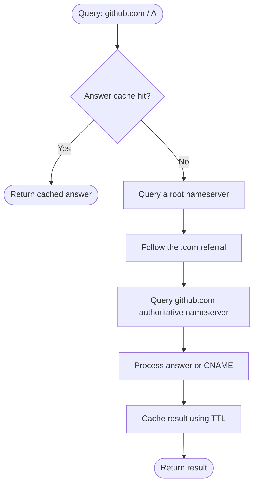
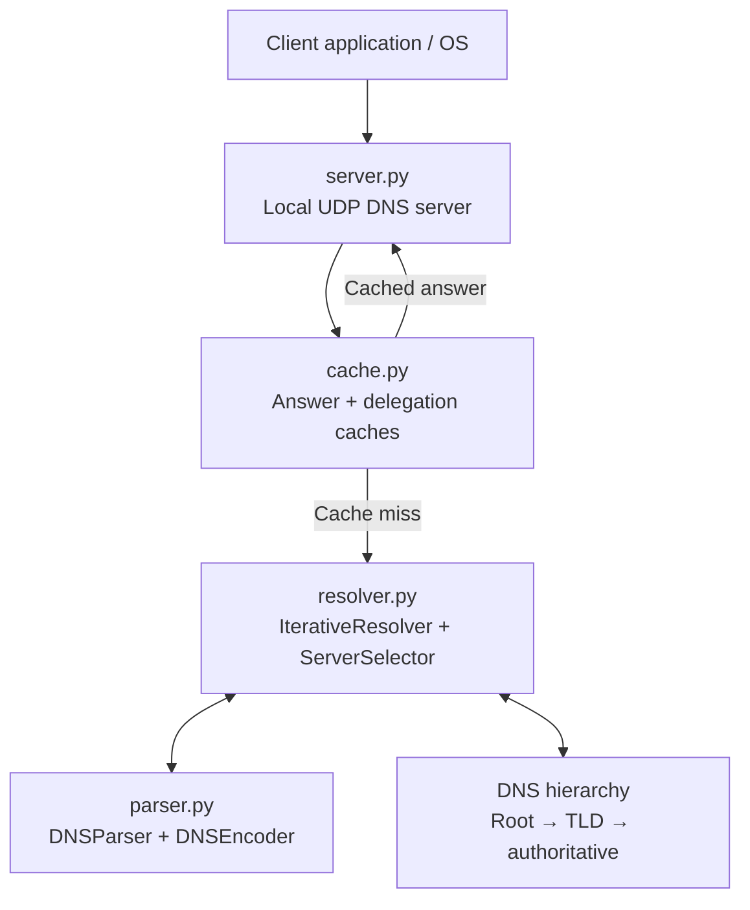
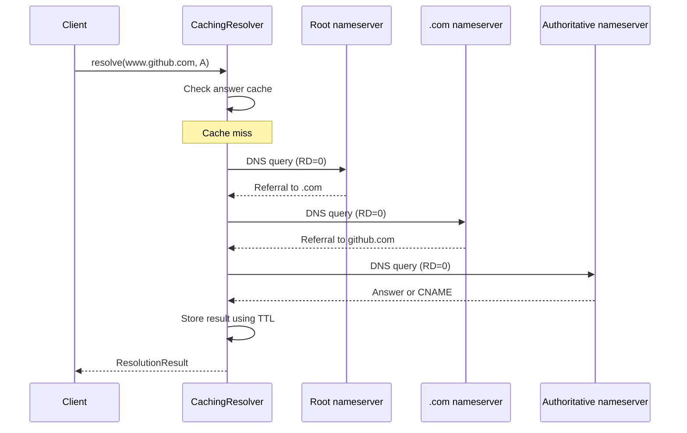
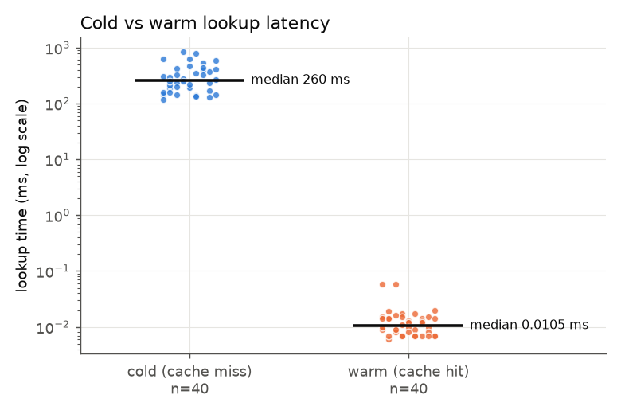
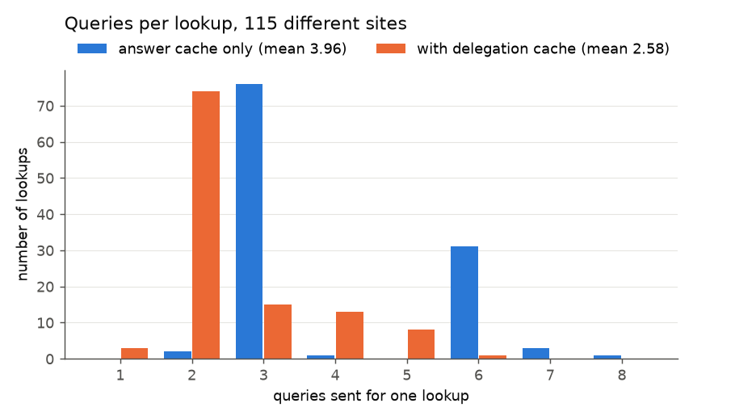
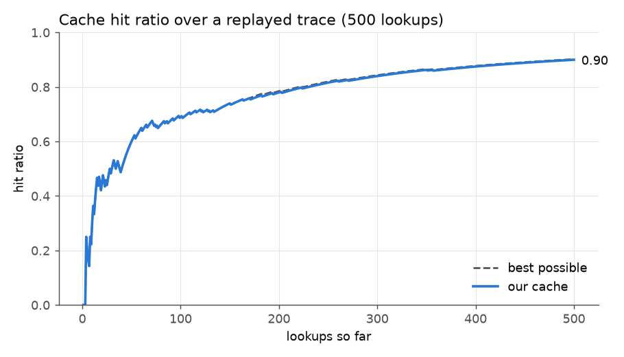
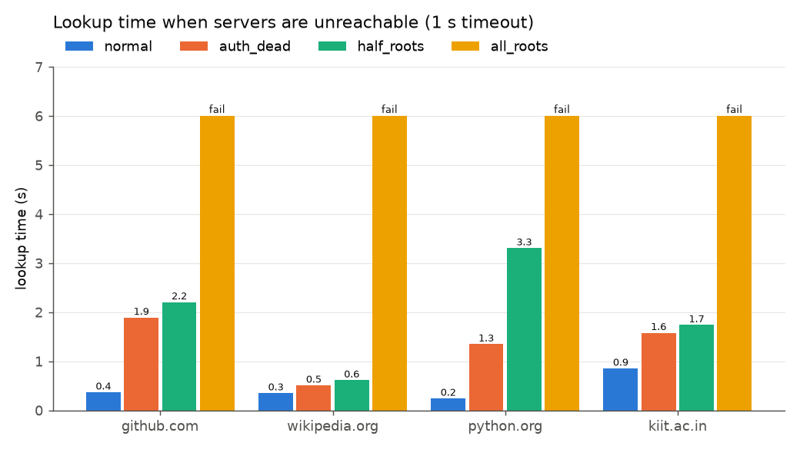
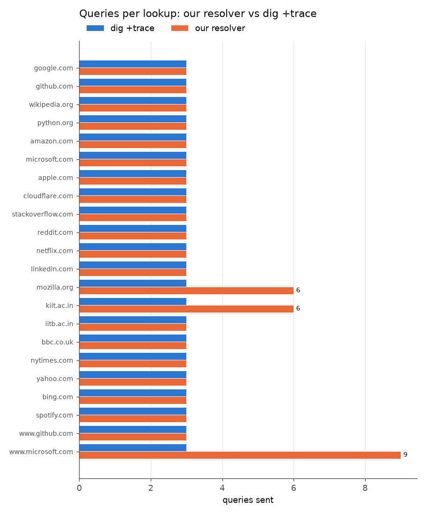

# RootRunner

<p align="center">
  
</p>

<p align="center">
  <strong>Follow DNS from the root servers to the answer.</strong><br>
  An iterative DNS resolver with TTL-aware caching, written in Python.
</p>

<p align="center">
  <a href="https://github.com/MaiCoderHoon/RootRunner/actions/workflows/tests.yml"></a>
  <a href="https://www.python.org/"></a>
  <a href="https://github.com/MaiCoderHoon/RootRunner/stargazers"></a>
  <a href="https://github.com/MaiCoderHoon/RootRunner/issues"></a>
  <a href="https://github.com/MaiCoderHoon/RootRunner/commits/main"></a>
</p>

RootRunner resolves DNS names **iteratively**. Instead of forwarding a query to a public recursive resolver, it starts with the DNS root, follows referrals to TLD nameservers, and continues to the authoritative nameserver. It also includes answer and delegation caches, RTT-aware nameserver selection, a command-line interface, and a local UDP DNS server.

> A cold lookup commonly follows the root → TLD → authoritative path. A warm answer-cache lookup can return in-process without another upstream DNS walk. Actual answers and timings depend on DNS records and network conditions.

---

## At a glance

- **Iterative resolution** — follows referrals with recursion desired disabled (RD=0).
- **DNS wire format** — parses and encodes DNS messages, including compressed domain names.
- **Caching** — TTL-aware positive and negative answer caching, plus delegation and glue caching.
- **Resilience** — retries alternate nameservers, tracks smoothed RTTs, and falls back to TCP for truncated upstream responses.
- **Record support** — A, AAAA, NS, CNAME, SOA, MX, and TXT.
- **Local resolver** — serves DNS queries over UDP on loopback.
- **Experiments** — repeatable scripts, CSV results, and plots for latency, query counts, cache behaviour, and failure handling.

## Contents

- [Quick start](#quick-start)
- [Try it](#try-it)
- [Architecture](#architecture)
- [Features and design](#features-and-design)
- [Python API](#python-api)
- [Local DNS server](#local-dns-server)
- [Tests and CI](#tests-and-ci)
- [Performance evaluation](#performance-evaluation)
- [Known limitations](#known-limitations)
- [Project structure](#project-structure)
- [DNS quest](#dns-quest)
- [References](#references)

---

## Quick start

### Requirements

- Python 3.12 or 3.13.
- Internet access that permits outbound DNS traffic over UDP and TCP port 53.
- No third-party packages are required to run the resolver itself.
- Install the project requirements for tests and experiment tooling.

### Install

Run commands from the repository root.

```bash
git clone https://github.com/MaiCoderHoon/RootRunner.git
cd RootRunner

python -m venv .venv

# Windows PowerShell
.venv\Scripts\Activate.ps1

# macOS / Linux
source .venv/bin/activate

python -m pip install -r requirements.txt
```

### First lookup

```bash
python -m src.dns_resolver.resolver github.com A
```

Inspect the nameserver walk:

```bash
python -m src.dns_resolver.resolver github.com NS --trace
```

Try a name that does not exist:

```bash
python -m src.dns_resolver.resolver doesnotexist-xyz123.com --trace
```

Run the test suite:

```bash
python -m pytest tests/ -q
```

---

## Try it

### Command-line example

The following is an illustrative example of the CLI output. The returned address, TTL, and hop count can change.

```console
$ python -m src.dns_resolver.resolver github.com A
;; github.com A: NOERROR, 3 hop(s)
github.com                     60      A      20.207.73.82
```

Add `--trace` to inspect the queried nameservers, zones, outcomes, and round-trip times.

### Follow a lookup



A later lookup may use the answer cache directly. If only delegation data is cached, the resolver can start at a lower point in the DNS hierarchy rather than repeating every referral step.

---

## Architecture



| Layer | Module | Responsibility |
|---|---|---|
| DNS wire format | `parser.py` | Header, question, and record parsing/encoding; compressed names; RDATA formatting. |
| Resolution | `resolver.py` | Iterative referrals, CNAME chains, glueless nameserver resolution, retries, TCP fallback, and RTT-aware server selection. |
| Caching | `cache.py` | TTL-aware answer cache, negative caching, delegation cache, and lookup logs. |
| Local server | `server.py` | UDP DNS server backed by the caching resolver. |

### Resolution sequence



### How responses are handled

| Response | Behaviour |
|---|---|
| Requested records | Return the answer, including CNAME records followed during resolution. |
| CNAME | Follow the canonical target from the closest known zone. |
| Child-zone NS records | Follow the referral, using glue when available. |
| NXDOMAIN | Return the negative answer and SOA authority data for negative caching. |
| Authoritative answer without the requested type | Return NODATA, which can be cached. |
| Other unexpected responses | Raise `ResolutionError`. |

---

## Features and design

### Iterative resolution and referrals

- Outgoing queries use `RD=0`; RootRunner performs the iterative walk itself.
- Follows referrals from root to TLD to authoritative nameservers.
- Uses glue records when available and resolves glueless nameservers when necessary.
- Rejects upward and sideways referrals to help prevent loops.
- CNAME restarts and nested glueless-nameserver lookups share a hop budget.
- The default maximum is 16 hops; exceeding it raises `HopLimitExceeded`.

### Nameserver selection and retries

RootRunner tracks a smoothed round-trip-time estimate (SRTT) for each nameserver IP.

- New servers receive a small random initial estimate.
- Successful responses update the estimate using an exponentially weighted moving average (alpha = 0.3).
- Failures increase the estimate, subject to a timeout floor, and move the server to the back of the queue.
- Estimates persist for the lifetime of the resolver object.
- Alternate nameservers are retried after timeouts, invalid replies, or SERVFAIL.
- Truncated upstream UDP responses are retried over TCP.

### Answer and delegation caching

`CachingResolver` maintains two caches:

| Cache | Key → value | Lifetime / behaviour |
|---|---|---|
| Answer cache | `(name, type) → full result` | Uses the shortest answer TTL. Negative answers use min(SOA TTL, SOA MINIMUM), following RFC 2308. |
| Delegation cache | `zone → nameservers and glue` | Uses the shortest TTL among NS and glue records. |

Additional behaviour:

- Cache hits report remaining TTL.
- Errors are not cached: a timeout does not establish that a name does not exist.
- The answer cache uses LRU eviction and defaults to 1,000 entries.
- Stale delegation data is discarded and resolution retries from the root.
- Lookup logs include HIT, NEGATIVE_HIT, MISS, ERROR, latency, query count, and starting zone; logs can be exported to CSV.

### DNS message handling

Supported record types: **A, AAAA, NS, CNAME, SOA, MX, and TXT** (class IN).

The parser and encoder handle DNS message headers, questions, resource records, and compression pointers. NS, CNAME, and MX RDATA can contain names compressed against the full DNS packet. When calling `format_rdata()` for these records, pass both the original packet and the RDATA offset.

### Design decisions

| Decision | Rationale |
|---|---|
| RD=0 on outgoing queries | RootRunner performs iterative resolution itself. |
| Bailiwick checks | Accept answer and glue data only within the relevant authority boundaries. |
| Reject upward and sideways referrals | Referrals must descend to a child zone that still contains the queried name. |
| Validate responses | Query ID, QR bit, and echoed question must match; IDs are generated using `secrets`. |
| Check TC before parsing the whole packet | A truncated packet may end mid-record; inspect the header and retry upstream over TCP. |
| Resolve glueless nameservers lazily | Resolve nameservers without known IPs only after known-address servers fail; nested lookups share the hop budget and use cycle protection. |
| Do not cache errors | A timeout or SERVFAIL is not a negative DNS answer. |
| Injectable transport and clock | `IterativeResolver(udp=..., tcp=...)` and `CachingResolver(clock=...)` support deterministic offline tests. |
| Parse server questions separately | The local server can handle unsupported query types without supporting every record type in the parser. |

---

## Python API

### Resolve a name

```python
from src.dns_resolver.resolver import IterativeResolver
from src.dns_resolver.parser import RecordType

resolver = IterativeResolver()
result = resolver.resolve("www.github.com", RecordType.A)

print(result.rcode.name)
print(result.addresses)
print(result.cname_chain)
print(result.hops)

for step in result.trace:
    print(step.zone, step.server, step.outcome, step.rtt_ms)
```

`ResolutionResult` exposes `qname`, `qtype`, `rcode`, `answers`, `authority`, `cname_chain`, `hops`, and `trace`. Each `ResourceRecord` has `name`, `type`, `ttl`, and a human-readable data value.

### Resolve with caching

```python
from src.dns_resolver.cache import CachingResolver
from src.dns_resolver.resolver import IterativeResolver

cache = CachingResolver()  # Answer cache + delegation cache
# cache = CachingResolver(IterativeResolver())  # Answer cache only

cache.resolve("github.com")       # MISS: starts from the root
cache.resolve("github.com")       # HIT: no upstream DNS queries
cache.resolve("www.github.com")   # May use cached delegation information

print(cache.stats())
cache.export_log_csv("lookups.csv")
cache.flush("github.com")
cache.clear()
```

### Build and parse a DNS packet

```python
from src.dns_resolver.parser import (
    DNSEncoder,
    DNSParser,
    DNSHeader,
    DNSQuestion,
    RecordType,
    RecordClass,
    ResponseCode,
    format_rdata,
)

header = DNSHeader(
    id=1234, qr=False, opcode=0, aa=False, tc=False, rd=False,
    ra=False, rcode=ResponseCode.NOERROR,
    qdcount=1, ancount=0, nscount=0, arcount=0,
)
question = DNSQuestion("google.com", RecordType.A, RecordClass.IN)
query = DNSEncoder().encode_message(header, [question])

# After sending the query and receiving reply bytes:
header, questions, answers, authority, additional = (
    DNSParser().parse_message(reply)
)

for record in answers:
    value = format_rdata(
        record.type,
        record.rdata,
        packet=reply,
        rdata_offset=record.rdata_offset,
    )
    print(record.name, record.ttl, value)
```

### Exceptions

| Exception | Meaning |
|---|---|
| `ResolutionError` | Resolution could not complete (for example, candidate servers failed, a lame delegation was encountered, or a CNAME loop was detected). Its trace records the attempted walk. |
| `HopLimitExceeded` | A `ResolutionError` subclass raised when the 16-hop budget is exceeded. |
| `ValueError` | Invalid domain name, such as an empty label, a label longer than 63 characters, a name longer than 253 characters, or non-ASCII input. Convert internationalised names to punycode first. |

---

## Local DNS server

RootRunner includes a local UDP DNS server backed by the caching resolver. By default it listens on loopback addresses `127.0.0.1` and `::1`, on port 53. Port 53 may require elevated privileges; use an unprivileged port for initial testing.

### Start the server

```bash
python -m src.dns_resolver.server

# Use an unprivileged port
python -m src.dns_resolver.server --port 5353

# Listen only on IPv4 loopback (instead of the default IPv4 + IPv6)
python -m src.dns_resolver.server --hosts 127.0.0.1
```

### Query it

```bash
nslookup github.com 127.0.0.1
nslookup -port=5353 github.com 127.0.0.1
```

Use the second command when the server is running on port 5353. Stop the server with Ctrl+C. On shutdown, cache statistics are printed and the per-lookup log is saved to `experiments/results/server_log.csv` by default; use `--log` to choose another path.

### Behaviour and safety notes

- Failed resolutions return SERVFAIL; the server keeps running.
- Replies over 512 bytes are truncated by setting the TC bit.
- Unsupported query types such as HTTPS (65) and PTR (12) receive an empty NOERROR response.
- The local server supports UDP only. Upstream truncated replies are retried over TCP by the iterative resolver.
- The project was validated for browsing on Windows 11. First verify the server with `nslookup`.
- If configuring Windows to use the local resolver, set IPv4 DNS to `127.0.0.1` and optionally IPv6 DNS to `::1`. Chrome Secure DNS may bypass the operating-system resolver during testing.

> **Important:** Restore DNS assignment to Automatic before stopping RootRunner. Otherwise, name resolution may stop working after the local server exits.

---

## Tests and CI

Run the full offline test suite:

```bash
python -m pytest tests/ -q
```

Run parser tests with verbose output:

```bash
python -m pytest tests/test_parser.py -v -s
```

| Test module | Main coverage |
|---|---|
| `tests/test_parser.py` | DNS headers, names and questions, compression pointers, supported record types, encoder round trips, and captured wire-format responses in `docs/responses/*.bin`. |
| `tests/test_resolver.py` | Referrals, CNAME chains and loops, NXDOMAIN/NODATA, retries, TCP fallback, glueless delegations, hop limits, and ServerSelector. Uses a fake network returning DNS wire-format packets. |
| `tests/test_cache.py` | TTL countdown, RFC 2308 negative caching, LRU eviction, error handling, delegation cache, stale-delegation retry, statistics, and CSV logging. Uses a stub resolver and fake clock. |
| `tests/test_server.py` | Question parsing, CNAME and AAAA replies, compression, cache hits, NXDOMAIN, SERVFAIL, unsupported types, malformed packets, and a local UDP socket round trip. |

The project README reports **100+ tests**, designed to run without internet access. Captured-response tests may be skipped when their fixture files are absent.

GitHub Actions runs the test workflow on pushes and pull requests to `main`, using Python 3.12 and 3.13. The workflow checks Black formatting, Flake8 code quality, and the pytest suite with coverage.

To capture a fresh real DNS response for parser testing (requires network access):

```bash
python scripts/capture_real_response.py
```

---

## Performance evaluation

RootRunner has five repeatable experiments and a real-world validation run. The full methodology, detailed tables, plots, and caveats are documented in [`experiments/RESULTS.md`](experiments/RESULTS.md). Raw CSVs are in `experiments/results/`; plots are in `experiments/plots/`.

### Results summary

| Experiment | Setup | Reported result |
|---|---|---|
| 1 · Cold vs. warm | 20 sites | Cold median: **250–281 ms**; warm median: about **0.01 ms**. |
| 2 · Delegation cache | 115 distinct sites; answer-only vs. answer + delegation cache | Queries per lookup: **3.96 → 2.58**; median latency: **288 → 180 ms**. |
| 3 · Cache replay | 500 lookups over 50 sites with Zipf-like popularity | Cache hit ratio: **0.90** (best possible for this trace: 0.902). |
| 4 · Unavailable nameservers | Simulated server failures | Resolution succeeds with 6 of 13 root servers unavailable. With all roots unavailable, it fails cleanly after 6 attempts rather than hanging. |
| 5 · Compared with `dig +trace` | 22 names | Query counts matched for **19 of 22** names. Differences reflect glueless NS address resolution and cross-zone CNAME handling. |
| OS validation | Windows 11 browsing through `server.py` | 207 filtered lookups, **0 errors**, hit ratio 0.39. |

### Experiment plots

<details open>
<summary><strong>1 · Cold vs. warm lookup latency</strong></summary>


</details>

<details>
<summary><strong>2 · Queries per lookup with delegation caching</strong></summary>


</details>

<details>
<summary><strong>3 · Cache hit ratio over a replayed trace</strong></summary>


</details>

<details>
<summary><strong>4 · Simulated unavailable nameservers</strong></summary>


</details>

<details>
<summary><strong>5 · Query count compared with dig +trace</strong></summary>


</details>

### Reproduce the experiments

Run from the repository root:

```bash
python -m experiments.exp1_cold_warm
python -m experiments.exp2_many_sites
python -m experiments.exp3_replay_trace
python -m experiments.exp4_dead_server
python -m experiments.exp5_vs_dig
python -m experiments.make_plots
```

Experiment 5 requires `dig`; edit the executable path at the top of its script if needed. Regenerating plots requires matplotlib and numpy. Experiments 2–5 overwrite their CSVs when rerun, so measurements may differ; Experiment 1 saves each run to a dated file. The experiments query DNS servers starting at the root rather than forwarding queries to a public recursive resolver.

**How to interpret the numbers:** The approximately 0.01 ms warm figure measures an in-process cache lookup, not a full DNS request over a socket. Experiments 2–5 are single runs on one network, not universal performance guarantees. See the full results report for methodology and caveats.

---

## Known limitations

RootRunner is a learning and experimentation project, not a hardened production DNS service. Do not expose it to untrusted networks.

- **IPv4-only upstream transport:** Root and authoritative servers are queried over IPv4, and only A glue is used. AAAA record lookups are supported, but upstream DNS transport does not use IPv6.
- **No EDNS0 or DNSSEC:** Local server replies use a 512-byte UDP budget; the resolver can read upstream responses up to 4096 bytes.
- **UDP-only local server:** For responses larger than 512 bytes, the server sets TC and sends no records. A client retrying over TCP cannot receive the response because there is no local TCP listener.
- **Minimal response sections:** The server omits the authority section, so NXDOMAIN responses have no SOA. SOA records are not packed into server replies; unsupported types receive empty NOERROR.
- **Serial lookup processing:** The cache is not thread-safe, so lookups are serialized with a lock. A slow cold lookup delays other clients; this is intended for one machine, not a high-traffic resolver.
- **Limited record coverage:** Supported types are A, NS, CNAME, SOA, MX, TXT, and AAAA, class IN only. SOA data is shown as raw hexadecimal; IPv6 addresses are printed without zero compression.
- **Network-dependent failures:** In the test network, `yandex.ru` failed and `westus-0.in.applicationinsights.azure.com` returned SERVFAIL. The precise causes were not conclusively established.
- **Internal coupling:** `DelegatingResolver` uses `IterativeResolver` internals such as `_Context`, `_NameServer`, and `_extract_referral`. Renaming them may require updates in `cache.py`.

---

## Project structure

```text
RootRunner/
├── .github/workflows/
│   └── tests.yml
├── assets/
│   └── rootrunner-logo.svg
├── src/dns_resolver/
│   ├── parser.py        # DNS wire format: DNSParser, DNSEncoder, format_rdata
│   ├── resolver.py      # IterativeResolver, ServerSelector, CLI
│   ├── cache.py         # CachingResolver, DelegatingResolver, DelegationCache
│   └── server.py        # Local UDP DNS server
├── tests/               # Offline unit tests
├── experiments/
│   ├── exp1_cold_warm.py
│   ├── exp2_many_sites.py
│   ├── exp3_replay_trace.py
│   ├── exp4_dead_server.py
│   ├── exp5_vs_dig.py
│   ├── make_plots.py
│   ├── filter_server_log.py
│   ├── results/         # CSVs and replay trace
│   ├── plots/           # PNG experiment plots
│   ├── validation/      # Windows browsing validation screenshots
│   └── RESULTS.md       # Full experiment report
├── scripts/
│   └── capture_real_response.py
├── docs/responses/      # Captured DNS response packets
├── requirements.txt
└── pytest.ini
```

---

## DNS quest

**Can you trace a domain from the root to its authoritative nameserver?**

A hands-on challenge board: each level uses a real RootRunner command or API call.

| Level | Mission | Try it | What to look for |
|---|---|---|---|
| 01 · First lookup | Resolve an IPv4 address | `python -m src.dns_resolver.resolver github.com A` | A successful answer and hop count. |
| 02 · Follow the trail | Inspect the nameserver path | `python -m src.dns_resolver.resolver github.com NS --trace` | Queried servers, zones, outcomes, and RTTs. |
| 03 · The missing domain | Handle a nonexistent name | `python -m src.dns_resolver.resolver doesnotexist-xyz123.com --trace` | The response code and negative-answer handling. |
| 04 · Cache speedrun | Compare first and second lookups | Use the [caching example](#answer-and-delegation-caching). | First lookup MISS, then HIT without upstream queries. |
| 05 · Research mode | Reproduce the performance study | Run the [experiment commands](#reproduce-the-experiments). | Cold/warm latency, query counts, hit ratio, and failure handling. |

<details>
<summary><strong>Quest checklist</strong> · track your progress</summary>

- [ ] Get a DNS answer.
- [ ] Explain the root → TLD → authoritative referral path.
- [ ] Explain the difference between NXDOMAIN and a resolver failure.
- [ ] Demonstrate a cache hit and explain TTL countdown.
- [ ] Reproduce at least one experiment and interpret its result.

**Bonus:** Run the local DNS server and query it with `nslookup`. Read the [local server safety notes](#behaviour-and-safety-notes) first.

</details>

---

## References

RootRunner implements DNS behaviour informed by:

- [RFC 1035 — Domain Names: Implementation and Specification](https://www.rfc-editor.org/rfc/rfc1035)
- [RFC 2308 — Negative Caching of DNS Queries](https://www.rfc-editor.org/rfc/rfc2308)
- [IANA — Root Server Technical Operations](https://www.iana.org/domains/root/servers)

