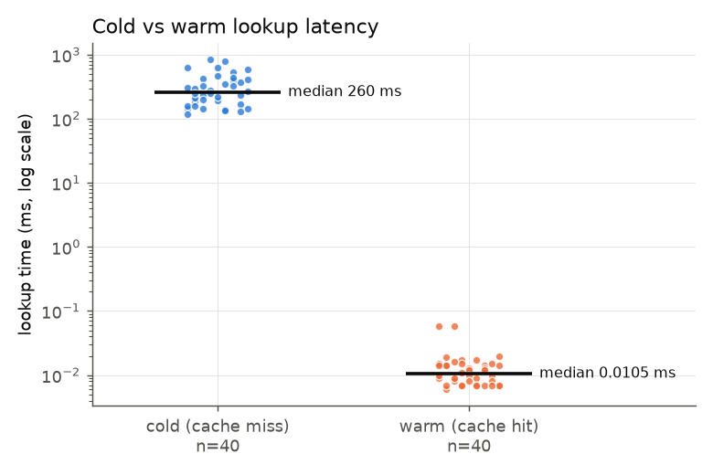
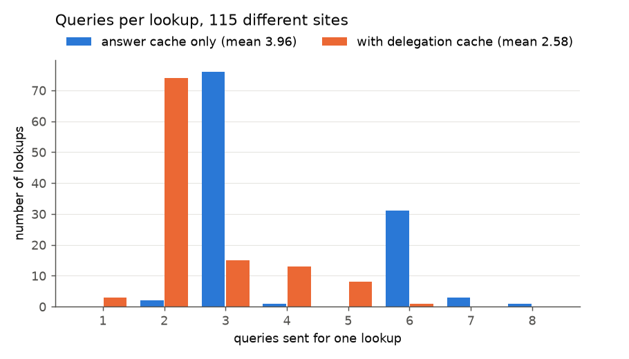
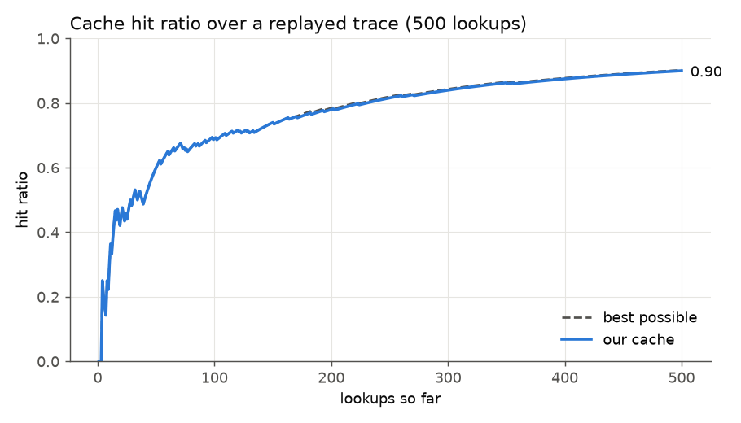
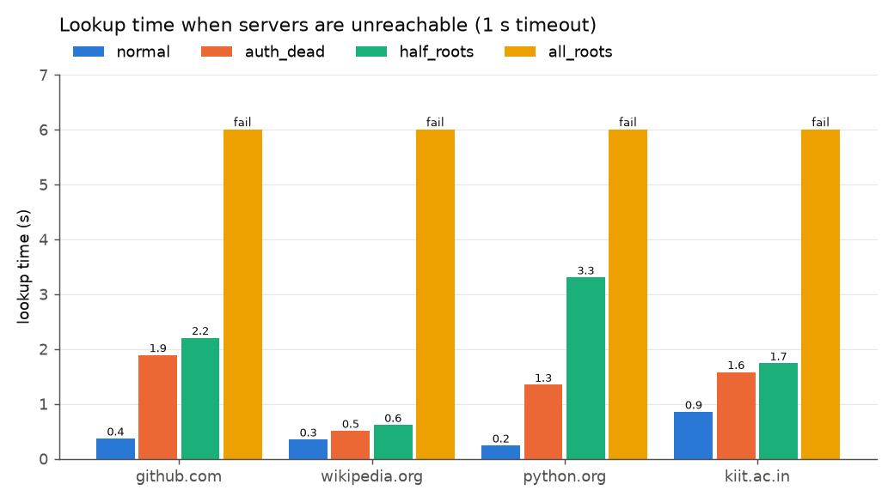
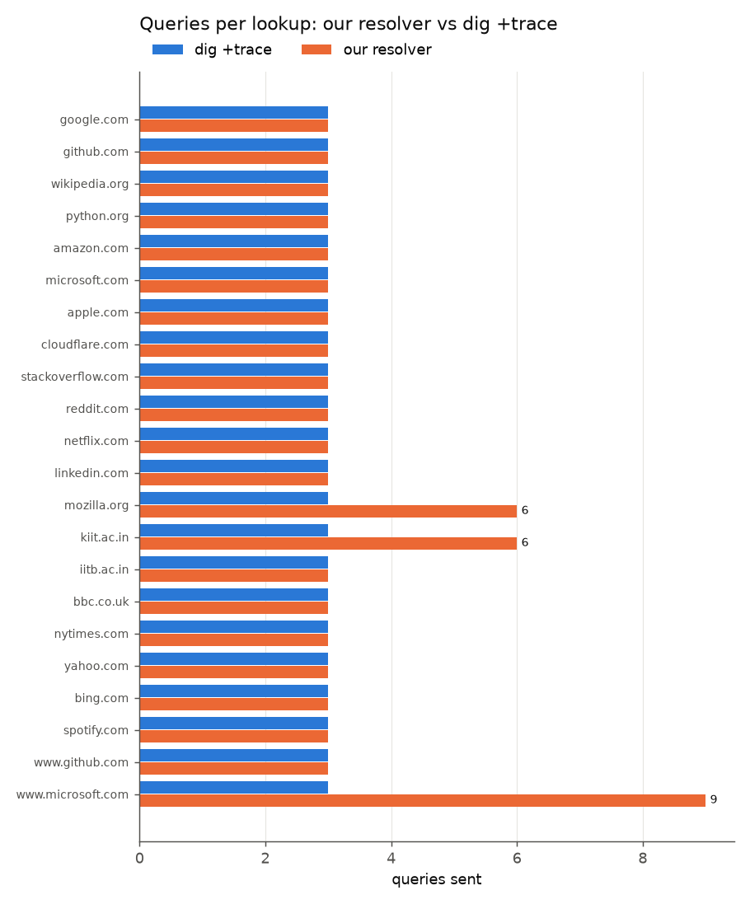
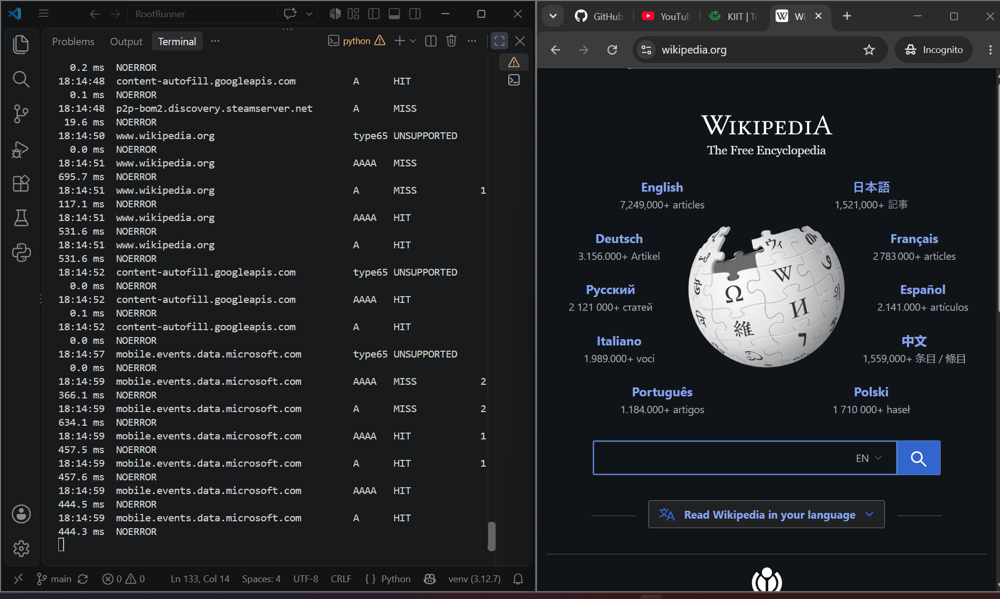
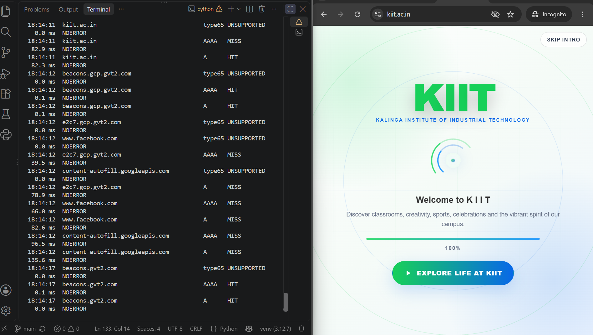
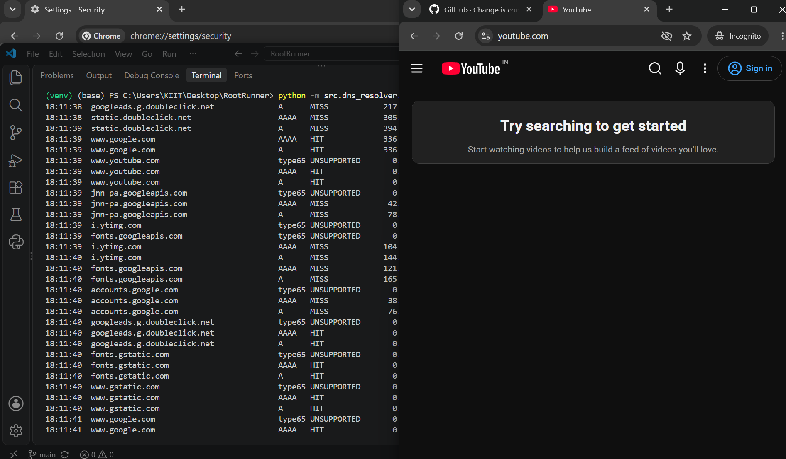

# Results: experiments and OS validation

Project P2, iterative DNS resolver with caching (CS-30003, Coding Assignment 1).

This file covers my part of the project: the five experiments, the plots, and the test where I pointed Windows at our resolver and browsed the web through it. Every number below comes from the CSV files in `experiments/results/`, and the plots in `experiments/plots/` are drawn from those same files.

## 1. Setup

- **Machine:** Windows 11 laptop, Python 3.12.7 in a venv.
- **Network:** home Jio Fiber over Wi-Fi (router at 192.168.29.1). Everything was run from this one network. I did not test on KIIT WiFi.
- **Resolver settings:** 2 s UDP timeout, 16 hops max, 6 server attempts per zone (the defaults). Experiment 4 uses a 1 s timeout so it finishes faster.
- **When:** 15 to 18 October 2026. Experiment 1 was run twice (Thursday 15 Oct afternoon, Friday 16 Oct night).
- **No shortcuts:** nothing is forwarded to 8.8.8.8 or any other public resolver. Every lookup starts at the 13 root servers.

Our cache has two parts, and some experiments switch one of them off:

- the **answer cache** keeps final answers until their TTL runs out;
- the **delegation cache** remembers which nameservers (and glue) a zone has, so a later lookup can skip the root and TLD and start lower down.

## 2. What the proposal claimed, and what we found

| Claim in the proposal | What we measured | Verdict |
|---|---|---|
| Cold lookup takes 100 to 300 ms | median 250 to 281 ms, but up to about 830 ms for some sites | median fits, tail does not |
| Warm lookup takes under 5 ms | about 0.01 ms | yes, by a wide margin |
| Cache is 50 to 100 times faster | about 24,000 times faster | far more than we guessed (see caveat in 3.1) |
| A cold lookup is 3 queries (root, TLD, authoritative) | 3 queries for 19 of 22 sites, same as `dig +trace` | yes, with 3 explained exceptions |

## 3. Experiments

### 3.1 Cold vs warm latency (`exp1_cold_warm.py`)

20 popular sites, answer cache only. First pass is cold (cache empty), second pass asks for the same names again (warm). I turned the delegation cache off here on purpose. With it on, the "cold" pass would not really be cold, because later sites could reuse nameservers learned from earlier ones.

| Run | Cold median | Cold range | Warm median | Warm range | Speed-up |
|---|---|---|---|---|---|
| Thu 15 Oct, 3:25 PM | 281.3 ms | 138.4 to 833.6 ms | 0.011 ms | 0.006 to 0.058 ms | about 25,600x |
| Fri 16 Oct, 10:48 PM | 249.5 ms | 118.4 to 799.5 ms | 0.010 ms | 0.007 to 0.058 ms | about 23,800x |

No errors in either run. The plot combines both runs (40 cold and 40 warm points).



I use the median because a few sites with long CNAME chains take 600 to 800 ms, and they would drag a mean upwards.

**Caveat:** the warm number is just the time to find the answer inside our own cache, with no network and no socket involved. So 24,000x is the speed-up of the cache itself, not of what a program sees end to end. That is probably why the proposal's guess of 50 to 100x was so much lower.

### 3.2 Many different sites (`exp2_many_sites.py`)

115 different sites, each looked up once, so the answer cache can never hit (hit ratio is 0 by design). I ran it twice: once with the answer cache only, once with the delegation cache on. The point is to see how much the delegation cache saves.

| | Answer cache only | With delegation cache |
|---|---|---|
| Lookups OK / failed | 114 / 1 | 114 / 1 |
| Queries per lookup, mean / median | 3.96 / 3 | **2.58 / 2** |
| Latency, median / mean | 287.8 / 369.3 ms | **180.1 / 248.8 ms** |
| Lookups that started at the root | 114 | **13** (the other 101 started lower down) |



With the delegation cache about a third fewer queries are sent and the median lookup is roughly 100 ms faster. The mean is higher than the median in both columns because a few sites need many queries: CNAME chains into other zones, or nameservers that come without glue.

`yandex.ru` failed in both runs ("no nameserver for zone 'yandex.ru' answered usefully"). It is a real unreachable-server case from my network, so I left it in. The plot shows the 114 that succeeded.

### 3.3 Cache hit ratio over a replayed trace (`exp3_replay_trace.py`)

A trace of 500 lookups over 50 sites. Popularity is Zipf-like (site number i gets weight 1/(i+1)), so a few sites are asked for very often and many rarely, which is closer to real traffic than picking uniformly. The random seed is fixed at 42, and the exact trace is saved in `results/exp3_trace.txt`, so anyone can replay it. Answer cache only.

- 49 of the 50 sites actually appeared in the trace.
- Result: **450 hits, 50 misses, hit ratio 0.90.**
- 49 of the 50 misses are first-ever lookups, which no cache can avoid. Only **1** miss was caused by a TTL running out. The best possible score for this trace was 451 out of 500.

| After lookups | 100 | 200 | 300 | 400 | 500 |
|---|---|---|---|---|---|
| Hit ratio | 0.69 | 0.78 | 0.84 | 0.875 | 0.90 |



**Caveat:** the whole trace runs in a few minutes, so TTLs hardly ever expire. This experiment shows the cache is not wasting hits, but it does not stress TTL eviction much.

### 3.4 When servers are unreachable (`exp4_dead_server.py`)

I did not unplug anything. I wrapped the function that sends UDP packets: for a "dead" server it waits the full 1 s timeout and then raises `socket.timeout`, exactly what a silent server looks like to the resolver. Each lookup uses a fresh resolver, so nothing is cached. Four scenarios: all servers fine, an authoritative server of the site dead, 6 of the 13 root servers dead, and all root servers dead.

| Site | Normal | Authoritative dead | 6 of 13 roots dead | All roots dead |
|---|---|---|---|---|
| github.com | 366 ms, 3 q | 1889 ms, 7 q, 1 timeout | 2203 ms, 5 q, 2 timeouts | failed after 6003 ms |
| wikipedia.org | 350 ms, 3 q | 507 ms, 3 q, 0 timeouts | 612 ms, 3 q, 0 timeouts | failed after 6003 ms |
| python.org | 240 ms, 3 q | 1346 ms, 7 q, 1 timeout | 3304 ms, 6 q, 3 timeouts | failed after 6003 ms |
| kiit.ac.in | 853 ms, 6 q | 1579 ms, 7 q, 1 timeout | 1737 ms, 7 q, 1 timeout | failed after 6003 ms |

(q = queries sent)



What I take from it:

- Every dead server the resolver tries costs one full timeout, and the lookup then still succeeds through another server. The price is one second per timeout plus a few extra queries.
- When all root servers are dead it gives up after 6 attempts of 1 s each (6 s total), which is `max_server_attempts`. It returns a clear error ("no nameserver for zone '.' answered usefully") and does not hang.
- The server-selection code does its job: lookups succeed even with half the roots dead.

**Caveats:** this is one run per cell. wikipedia.org shows 0 timeouts only because the resolver happened to pick live servers first, and the difference between python.org (3.3 s) and github.com (2.2 s) in the half-roots column is mostly luck of the draw. Repeating each cell about 5 times would be the proper way. Also the outages are simulated, not real.

A real sighting from the browsing test (section 4): `api.github.com` took 2148 ms and 4 queries once. That looks like one nameserver missing the 2 s timeout and the next one answering, but I did not trace it to confirm.

### 3.5 Query count compared with dig (`exp5_vs_dig.py`)

22 names, each resolved by our resolver and by `dig -4 +trace +nodnssec`. I counted the queries sent in each case. The first line dig prints, the query to my router asking for the root list, is not counted.

**Same number of queries on 19 of 22 names** (3 each).



The three differences, and why:

| Name | dig | ours | Reason |
|---|---|---|---|
| mozilla.org | 3 | 6 | The nameservers came without glue. We spend 3 extra queries finding a nameserver's IP address. dig asks my router for that and does not show it. |
| kiit.ac.in | 3 | 6 | Same reason. |
| www.microsoft.com | 3 | 9 | CNAME chain that leaves the zone (into Akamai). Each new zone is a fresh 3-query walk. dig +trace stops at the first CNAME, our resolver follows it to the final address. |

`www.github.com` is a CNAME too, but it points into the same zone and the answer comes in the same reply, so it stays at 3 on both sides. So the extra queries are our resolver doing more work than `dig +trace`, not doing it worse. Matching counts do not prove both sides talked to the same servers; I only compared the counts.

## 4. OS validation: browsing the web through our server

### What I did

`src/dns_resolver/server.py` listens on UDP port 53 on `127.0.0.1` and `::1`. For each question it asks the caching resolver, packs the answer (names are compressed using the team's `encode_name`), and sends it back. If the resolver fails it replies SERVFAIL. If a reply would be over 512 bytes it sets the TC bit. It prints one line per lookup and saves a log when I press Ctrl+C. Browsers also ask for record types our parser does not know (HTTPS, type 65, and PTR, type 12). Those get an empty NOERROR answer instead of an error.

Steps on Windows 11:

1. Started the server in one terminal.
2. Tested it with `nslookup github.com 127.0.0.1` before changing any setting.
3. Settings, Network & internet, Wi-Fi, Hardware properties, DNS server assignment: set to Manual, `127.0.0.1` for IPv4 and `::1` for IPv6.
4. Turned off "Use secure DNS" in Chrome, otherwise Chrome skips the Windows resolver completely.
5. Opened github.com, wikipedia.org, kiit.ac.in and youtube.com in an incognito window, with the server terminal next to it.
6. Stopped the server with Ctrl+C and set DNS back to Automatic.

### First test, before touching any setting

| Lookup | Result | Time | Queries |
|---|---|---|---|
| `github.com` A (cold) | 20.207.73.82 | 430 ms | 3 |
| `www.github.com` A | CNAME to github.com, then 20.207.73.82 | 20 ms | 1 |
| `doesnotexist-xyz123.com` A | NXDOMAIN | 50 ms | 1 |
| `doesnotexist-xyz123.com` A, asked again | NXDOMAIN from the negative cache | 0.04 ms | 0 |

`www.github.com` needed only 1 query because the delegation cache already knew github.com's nameservers. The second NXDOMAIN lookup is the negative cache working.

### Proof that Windows used our server

With the setting changed and the server running, I ran `nslookup github.com` without naming a server. Windows answered with our server's address:

```
> nslookup github.com
Server:  UnKnown
Address:  ::1

Non-authoritative answer:
Name:    github.com
Address:  20.207.73.82
```

(`UnKnown` is normal: nslookup tries to find a name for the server's address and we answer that question with an empty reply. `::1` is the IPv6 localhost address, and Windows prefers IPv6 when both are set.)

After switching DNS back to Automatic the same command shows the router instead (`Server: reliance.reliance`), so my laptop is back to normal.

The screenshots show the pages loaded in the browser with the server terminal next to them. The time on the terminal lines matches the pages loading:





### Numbers from the session

The server printed these stats when I stopped it (whole session, about 30 minutes):

- 352 lookups: 121 hits, 8 negative hits, 223 misses, 6 errors, 0 evictions.
- Hit ratio **0.3665**. The delegation cache was used 210 times and held 97 entries.

That log includes Windows and background apps (WhatsApp Web, OneDrive, Steam, VS Code and so on), which also use the system DNS. I did not want those names in a public repo, so `experiments/filter_server_log.py` keeps only the sites I opened and their page assets, and writes `results/server_log_browsing.csv`. The raw log stays on my laptop only. The filtered numbers:

- 207 lookups, 81 hits, **0 errors**, hit ratio **0.3913**.

### Why the hit ratio is so much lower than the 0.90 in experiment 3

- Browsing keeps meeting new names. One page loads 20 to 30 domains (ads, fonts, analytics). Opening kiit.ac.in also looked up Facebook and Google Analytics, because the page loads their scripts. The filtered log has about 49 different names, each asked as A and AAAA, so roughly 95 lookups out of 207 had to be misses. My rough ceiling for this session is about 0.54, not 0.90.
- Some TTLs are short. `github.com` and `api.github.com` (A) have 60 s, and I came back to them after 90 to 180 s, so they had expired. Google names have 300 s, and Chrome asked again after more than 5 minutes. That is correct cache behaviour.
- Experiment 3 replays popular sites over and over. A real session does not repeat that much. So the hit ratio depends on the traffic, not only on the cache.

### Things I noticed

- Pages loaded fine. The first visit to a site was a bit slower (cold lookups of 200 to 800 ms each), and reloads were fast.
- The 6 errors are all the same name, `westus-0.in.applicationinsights.azure.com` (VS Code telemetry). The server answered SERVFAIL after about 0.8 s each time and kept running. I did not find out why it fails.
- The times printed on the terminal can be much higher than the times in the CSV for cache hits (for example 1127 ms on screen for a hit that took 0.05 ms in the log). The server handles one lookup at a time, and the on-screen timer also counts the time a request waited behind a slow lookup. See limitations.

## 5. Limitations

- **One network.** Everything ran on my home Jio connection, mostly in one evening each. Numbers from KIIT WiFi or mobile data would be different.
- **Single runs.** Experiments 2 to 5 were run once each. Experiment 4 especially would be stronger with repeats.
- **Simulated outages.** Experiment 4 simulates dead servers by wrapping the send function. A real outage can also mean a server that answers slowly or wrongly.
- **Server is UDP only.** There is no TCP listener. If a reply is over 512 bytes the server sets the TC bit and sends no records, and a client that retries over TCP gets no answer. The resolver itself does use TCP when upstream servers set TC.
- **No EDNS, no DNSSEC.** Replies are plain 512-byte DNS.
- **Replies are minimal.** The server sets no authority section, so an NXDOMAIN reply carries no SOA record. SOA records are not packed into replies. Types we do not support (HTTPS, PTR) get an empty NOERROR.
- **One lookup at a time.** The cache is not thread safe, so the server puts a lock around it. A slow cold lookup makes other requests wait. This is fine for one laptop and not for a busy server.
- **The yandex.ru and applicationinsights failures** are not explained. They look like unreachable or unhelpful nameservers, but I did not trace them to the end.

## 6. How to reproduce

Run everything from the project folder with the venv on.

```
python -m pytest tests/ -q
```

110 tests pass (100 from the team and 10 for the server).

```
python -m experiments.exp1_cold_warm
python -m experiments.exp2_many_sites
python -m experiments.exp3_replay_trace
python -m experiments.exp4_dead_server
python -m experiments.exp5_vs_dig
python -m experiments.make_plots
```

Experiment 5 needs `dig` (I used the BIND 9.16 Windows build at `C:\dig\dig.exe`). Experiments 2 to 5 overwrite their CSV files when re-run, so the numbers in this file would change. Experiment 1 saves each run to its own dated file.

To try the server:

```
python -m src.dns_resolver.server
```

then in a second terminal `nslookup github.com 127.0.0.1`. It uses port 53; if that is busy, add `--port 5353` and `nslookup -port=5353 github.com 127.0.0.1`. Ctrl+C stops it and saves the log to `experiments/results/server_log.csv`. To make the filtered copy from that log: `python -m experiments.filter_server_log` (it needs the raw log, which is only on my laptop).
